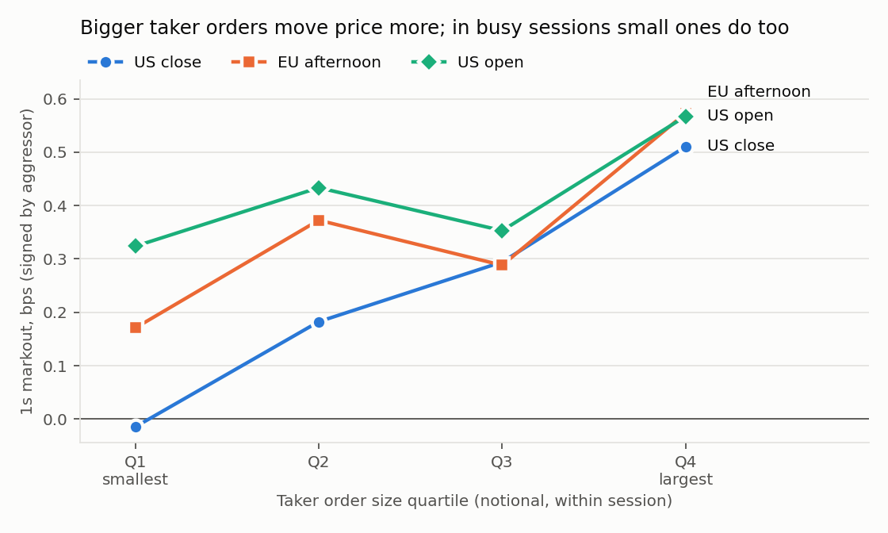
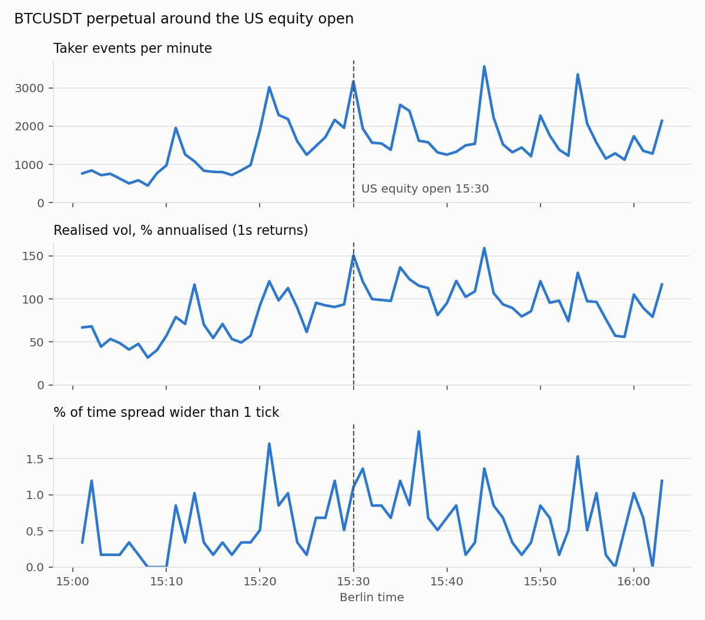

# orderbook-lab

A small, honest study of Binance USD-M perpetual microstructure (default: BTCUSDT).
It records the public order book and trades, then measures what a market maker cares about:
how wide the spread is, how much size sits near the mid, and whether trades are followed by
adverse price moves (markouts).

## Questions
1. How do spread and near-mid depth vary through the day?
2. Are larger aggressive trades more "informed", i.e. do they have larger positive markouts at 1s / 5s / 30s?
3. Does top-of-book imbalance or microprice say anything about the next few seconds of mid moves?

## Setup
```bash
pip install -e .[dev]
pytest                                   # offline tests on synthetic data
python -m orderbook_lab.recorder --symbol btcusdt --minutes 60 --out data/
python -m orderbook_lab.report --data data/ --out report.md            # one session
python -m orderbook_lab.report --data data/ --start 15:30 --end 16:05   # a Berlin-time window
python -m orderbook_lab.compare data_a data_b@14:00-15:30 --out compare.md
python -m orderbook_lab.plots data_a data_b@14:00-15:30 --labels A B --open-window data_b@15:00-16:05
```

## What is measured
| Metric | Definition |
|---|---|
| Spread (bps) | (ask₀ − bid₀) / mid × 10⁴ |
| Microprice | (bid₀·askQty₀ + ask₀·bidQty₀) / (bidQty₀ + askQty₀) |
| Depth within X bps | Sum of quantity on levels within X bps of mid (top 20 levels only) |
| Imbalance | (bidQty − askQty) / (bidQty + askQty) over the first k levels |
| Markout at h | side × (mid(t+h) − mid(t−)) / mid(t−) × 10⁴, using only data before the trade for mid(t−) |
| Realised vol | Std of 1s log mid returns, annualised over 365×24×3600 s |

## Results so far (BTCUSDT, Nov 2026, three sessions)

| | US close (11-11, 21:57-22:57) | EU afternoon (11-12, 14:04-15:29) | US open (11-12, 15:30-16:04) |
|---|---:|---:|---:|
| Taker events / min | 230 | 931 | 1,759 |
| Share of events sweeping >1 level | 20.9% | 27.3% | 31.4% |
| Realised vol (annualised, 1s) | 28% | 71% | 104% |
| Median spread | 1 tick (0.013 bps) | 1 tick (0.014 bps) | 1 tick (0.014 bps) |
| Time spread > 1 tick | 0.1% | 0.4% | 0.7% |
| Top-5 depth, both sides (median) | 9.2 BTC | 11.6 BTC | 9.8 BTC |
| corr(5-level imbalance, next 5s return) | +0.21 | +0.13 | +0.11 |
| 1s markout per taker event | 0.24 bps | 0.35 bps | 0.42 bps |
| 1s markout, smallest / largest size quartile | -0.02 / 0.51 bps | 0.17 / 0.57 bps | 0.32 / 0.57 bps |
| 1s markout, notional-weighted | 0.99 bps | 1.10 bps | 1.08 bps |
| Placebo (random signs), 1s | -0.001 | 0.011 | 0.002 |




What the numbers say:
1. **Activity scales, the touch does not.** Taker flow rose ~8x from the quiet evening to the US open, yet the spread stayed at one tick more than 99% of the time and top-5 depth stayed around 10 BTC. On 11-12 the pick-up started around 15:10-15:20, before the equity open, so 15:30 is not a clean break in this sample.
2. **Adverse selection dwarfs the spread.** With a one-tick spread (0.013 bps), the average taker event is followed by a 0.24-0.42 bps move in its direction within 1s (about 1 bps notional-weighted). Earning the spread alone does not pay for being picked off.
3. **Size carries information, and in busy markets small orders do too.** Markouts rise with order size in every session. The largest quartile is stable (~0.55 bps); the smallest goes from noise (≈0) in the quiet evening to 0.32 bps after the US open.
4. **Book imbalance predicts short-term moves, less so when the market is busy** (correlation 0.21 → 0.11). One possible reason is that 100 ms snapshots lag a faster-changing book; this data cannot tell.

Method notes: aggTrades with the same match time and side are collapsed into one taker event (a market order sweeping several levels arrives as several aggTrades; counting them separately tripled the naive markout). Markouts use the bookTicker mid strictly before the trade as reference. The placebo assigns random signs at the same timestamps and should be ≈0, which it is.

## Limitations (read before quoting any number)
- `depth20@100ms` is a **sampled partial book**: it can miss changes between snapshots and only sees 20 levels.
  A full diff-depth book (REST snapshot + `@depth` updates with sequence checks) is the next step.
- Exchange event time is used throughout; network latency to the recorder is stored (`recv_ns`) but not corrected.
- Markouts use overlapping windows, so per-trade values are correlated; treat means as descriptive, not significant.
- No fees, queue position or latency are modelled, so nothing here is a trading strategy.
- Three sessions over two days: time-of-day and day effects are confounded, and 11-12 was a high-volatility day. The US-open window is only 34 minutes.

## Layout
```
src/orderbook_lab/recorder.py   websocket -> chunked parquet (reconnects, flushes every 60s)
src/orderbook_lab/metrics.py    spread, microprice, depth, imbalance, markouts, realised vol
src/orderbook_lab/report.py     markdown summary of a recording (optionally a time window)
src/orderbook_lab/compare.py    side-by-side table of several sessions/windows
src/orderbook_lab/plots.py      README figures
tests/test_metrics.py           unit tests incl. a look-ahead check for markouts
```
